## Hi there 👋
- ...
- 🔭  I’m currently working on -- myself 
- 💬  Ask me about -- nothing
- ⚡  Fun fact: you dont have a life

kill yourself for me 🤔
---

<!--
**NETANEL576/NETANEL576** is a ✨ _special_ ✨ repository because its `README.md` (this file) appears on your GitHub profile.

Here are some ideas to get you started:

-  ...
- 🌱 I’m currently learning ...
- 👯 I’m looking to collaborate on ...
-  I’m looking for help with ...
-
- 📫 How to reach me: ...
- 😄 Pronouns: ...

-->

<picture>
  <source media="(prefers-color-scheme: dark)"  srcset="https://raw.githubusercontent.com/netanel576/netanel576/output/snake-dark.svg">
  <source media="(prefers-color-scheme: light)" srcset="https://raw.githubusercontent.com/netanel576/netanel576/output/snake-light.svg">
  
</picture>
